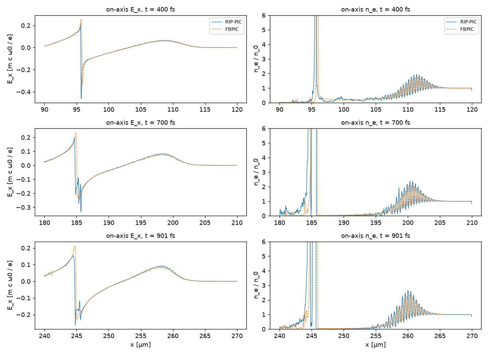
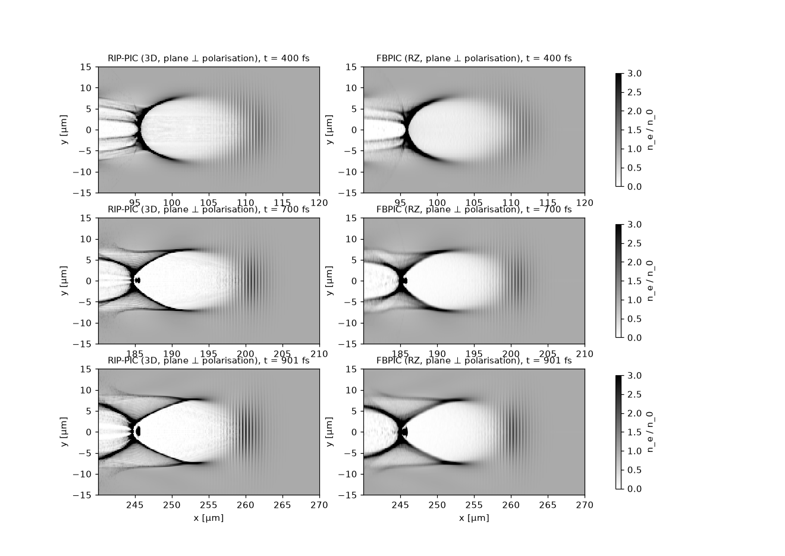

# Bubble-regime LWFA benchmark: VLPL against FBPIC

Phase 1 exit criterion "LWFA bubble vs FBPIC" (docs/ROADMAP.md), strongly nonlinear version. The
mildly nonlinear a0 = 1 case is `bench/lwfa_fbpic/`.

## Setup (the same in both codes, lab frame, mobile ions in both)
- Laser: λ0 = 0.8 µm, a0 = 4, linear polarisation, duration 20 fs (intensity FWHM; FBPIC
  τ = 20 fs / sqrt(2 ln 2)), waist 7.2 µm focused at x = 0. The centre crosses x = 0 at 40 fs.
  VLPL injects the pulse through the open left boundary; FBPIC initialises it at z0 = -c 40 fs.
- Plasma: 0.005 n_c (8.7e18 cm^-3, λp = 11.3 µm, c/ωp = 1.8 µm), a linear up-ramp from 32 to
  52 µm, then flat. Electrons and protons (m_p) are both mobile in both codes.
- Matched bubble: k_p w0 = 2 sqrt(a0) = 4, bubble radius R ≈ w0 = 7.2 µm, c τ ≈ 0.5 λp.
- Moving window at c. From 100 fs on, both boxes are [c (t - 100 fs), c (t - 100 fs) + 30 µm] (VLPL starts at 99.8 fs, so its box is 0.06 µm ahead, decision 91): the laser
  centre is 12.0 µm = 3.3 σ (field rms 12 fs) behind the front edge, and c · 100 fs = 29.98 µm stays
  within the box length (the laser head does not reach VLPL's open right edge before the window
  moves; with an earlier start of 80 fs the bubble ran into the back edge).
- Grid: dx = dz = 0.05 µm (λ/16), c dt = dx, 6000 steps (1 ps, the laser ~236 µm into the plateau).
  - VLPL: 3D, 600 × 160 × 160, dy = dz = 0.25 µm, periodic in y and z (40 µm).
  - FBPIC: RZ with 2 modes, Nr = 80, dr = 0.25 µm (r_max = 20 µm, reflective), PSATD of infinite
    order.
- Particles:
  - VLPL: electrons 2 × 2 × 2 per cell, protons 1 per cell, regular lattice, shape 2.
  - FBPIC: 2 × 2 × 8 per cell for both species, cubic shape.
- Output every 600 steps (100 fs).

## Run
VLPL needs a GPU (15.4 M cells, 138 M particles, about 10 GB; estimate 20-30 min on an RTX
5090). FBPIC runs on a GPU with `--cuda`, or on many CPU cores (3 M particles; hours on 4 cores).
```
make -j CUDA=1 CUDA_ARCH=-arch=sm_120 BUILD=build-gpu
build-gpu/vlpl bench/lwfa_bubble/rip.deck                        # out_bubble_rip/
pip install fbpic pyfftw openpmd-viewer h5py scipy
python3 bench/lwfa_bubble/fbpic_bubble.py out_bubble_fbpic [--cuda]
python3 bench/lwfa_bubble/compare.py out_bubble_rip out_bubble_fbpic [tol_laser tol_length tol_l2]
python3 bench/lwfa_bubble/plot_onaxis.py out_bubble_rip out_bubble_fbpic bubble_onaxis.png
python3 bench/lwfa_bubble/plot_snapshots.py out_bubble_rip out_bubble_fbpic bubble_ne.png ne   # or ex
```
FBPIC on an RTX 5090 (sm_120, driver CUDA 13.0) worked with Python 3.12, numba 0.68, numba-cuda
0.30.4 (cu13), cupy-cuda13x 14.2 and numpy < 2.5, with the pip CUDA libraries pinned to the driver's
version: `pip install "cuda-toolkit[nvrtc,nvvm,cublas,cufft,curand,cusolver,cusparse,cudart,cccl,nvjitlink]==13.0.*"`.
`compare.py` prints, per output time, on axis:
- the peak laser field of both codes;
- the bubble length: from the laser (peak of the field envelope) to the bubble back (the minimum
  of Ex in the first bucket, the accelerating spike);
- the peak accelerating field there (-min Ex, units m c ω0 / e);
- the smallest electron density n_e / n_0 between the bubble centre and the laser (cavitation);
- the relative L2 difference of Ex over the first bucket.

Then it prints the charge, the mean energy and the maximum energy of the injected electrons
(γ >= 20) in both codes: VLPL's `diagnostic injected` block against FBPIC's particle output. This
is reported, not gated.

It exits 1 if the laser field, the bubble length or the first-bucket L2 differ by more than the
tolerances (default 10 %, 5 %, 0.25). These are first guesses: the run sets them. Outputs with no
wake yet are skipped. Self-injection is chaotic in this regime, so the field behind the first
bucket is not compared, and the injected electrons are reported but not gated.

## Smoke test (cloud session, 4 cores)
Coarse transverse grid (32 × 32 cells of 0.75 µm in VLPL, r_max = 10 µm in FBPIC), 1 ppc, 1500
steps: it checks that the three scripts run and produce comparable output, not the physics.
```
build/vlpl bench/lwfa_bubble/rip.deck grid.ny=32 grid.nz=32 grid.dy=0.75um grid.dz=0.75um \
    grid.t_end=250.2fs output.slice_every=300 output.dir=rip "species electrons.ppc_x=1" \
    "species electrons.ppc_y=1" "species electrons.ppc_z=1"
python3 bench/lwfa_bubble/fbpic_bubble.py fb --steps 1500 --period 300 --rmax 10
python3 bench/lwfa_bubble/compare.py rip fb
```

Smoke result (2026-10-27): the scripts run; at 250 fs bubble length 11.05 µm (VLPL) against
11.25 µm (FBPIC), accelerating field 0.098 against 0.109, laser 3.85 against 4.01; VLPL 656 s,
FBPIC 17 min (2 threads each). The first-bucket L2 at 200 fs (0.48, the bubble just forming on a
0.75 µm transverse grid) is above the tolerance; physics needs the full grid.

## Results
Full runs on the RTX 5090 of the GPU workstation, 2026-10-27: both codes on the GPU. Details are in
docs/GPU_TESTING.md, "Eleventh check".

| | VLPL | FBPIC |
|---|---|---|
| wall time | 1336 s | 160 s |
| macro-particles | 138 M | 3.1 M |

**Plots** (made with `plot_onaxis.py` and `plot_snapshots.py`, at 400, 700 and 900 fs):




**compare.py** (window start 100 fs):

| t [fs] | E_las RIP | FB | L_b RIP [µm] | FB | E_acc RIP | FB | L2 |
|---|---|---|---|---|---|---|---|
| 300 | 3.727 | 3.692 | 11.35 | 11.40 | 0.2004 | 0.1794 | 0.784 |
| 500 | 4.093 | 3.999 | 12.10 | 12.10 | 0.2088 | 0.1978 | 0.693 |
| 700 | 4.887 | 4.676 | 11.85 | 11.90 | 0.2018 | 0.2047 | 0.640 |
| 900 | 5.316 | 5.041 | 11.30 | 11.65 | 0.1769 | 0.2011 | 0.523 |

- **Laser field:** within 5.5 %.
- **Bubble length:** within 0.35 µm.
- **Accelerating field:** within 12 %.
- **First-bucket L2:** 0.52-0.83, above the tolerance of 0.25. It comes from the sharp spike at the
  bubble back: VLPL's sits 0.1-0.3 µm behind FBPIC's, and from 700 fs on it is reshaped by the
  injected bunch. The wake in front of the spike agrees closely.
- **Bubble shape:** the bubbles and sheaths have the same shape and radius.

**Injected electrons (γ >= 20) at 900 fs:**

| | charge | mean energy | maximum energy |
|---|---|---|---|
| VLPL | 118 pC | 75 MeV | 188 MeV |
| FBPIC | 77.5 pC | 84 MeV | 134 MeV |

- **FBPIC is converged in particle number:** with 4x and 16x the particles it gives 77.1 and 75.6 pC.
- **VLPL injects 1.5-1.7x more:** probably an effect of the coarse transverse grid (0.25 µm = 5 dx
  in 3D Cartesian geometry), not a problem for the benchmark.

**Gauss law in VLPL:**
- **Until 2026-11-09:** max|dGauss| was 1.05e-4 (steps 620-1140) and 1.95e-7 (to step 1620), then
  1e-13 .. 3e-12. Decision 91 found two causes:
  - **The laser head (1.05e-4, also in max|div B|).** It appeared at step 620, before any plasma had
    entered. The head of the pulse injected from t = 0 reached the open right edge one step before the
    first shift (c window.start = 29.98 um, L = 30 um). Exactness needs c start + dx <= L. Fixed by
    window.start = 99.8 fs; the start warning now tests c start + dx > L.
  - **The plasma entry (1.95e-7).** The electrons (2 x 2 x 2 per cell) and the protons (1 per cell) put
    different charges on the nodes of the ramp. That charge entered with no field. It is now kept as a
    background in gauss0, as for an initial load.
