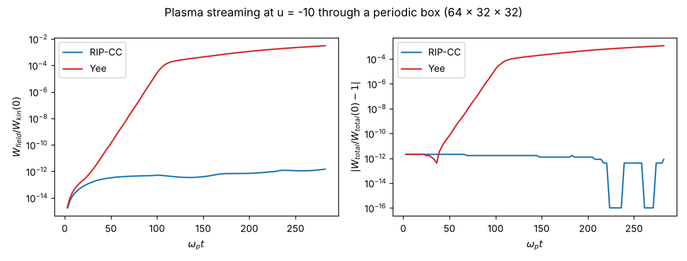

# Numerical Cherenkov instability: RIP-CC against Yee

The test of Pukhov, JCP 418, 109622 (2020), Sec. 7.1, with `examples/streaming_plasma.deck`:
- a neutral electron-positron plasma, n = 0.01 n_c (ω_p = 0.1 ω0), streams at u = −10 along x
  through a periodic box of 64 × 32 × 32 cells;
- h_x = 0.63 c/ω_p, h_y = h_z = 1.88 c/ω_p, 8 particles per cell, shape 1;
- small temperature (u_th = 1e-4).

The only difference between the two runs is `numerics.solver`:
- RIP-CC: c Δt = h_x, 448 steps;
- Yee: cfl 0.98, Δt = 0.886 h_x, 506 steps.

Both reach ω_p t = 282.

```
sh bench/nci/run.sh build/vlpl      # about 80 s per run on 2 cores
python3 bench/nci/plot.py             # -> bench/nci/nci.png
```



## Result (2026-10-27, main + branch yee)
| ω_p t | W_field / W_kin(0), RIP-CC | W_field / W_kin(0), Yee | W_total / W_total(0) − 1, Yee |
|---|---|---|---|
| 28 | 1.7e-13 | 8.2e-13 | 0 |
| 56 | 4.0e-13 | 5.4e-10 | 3.0e-10 |
| 84 | 4.8e-13 | 4.8e-7 | 2.7e-7 |
| 112 | 3.6e-13 | 1.5e-4 | 7.7e-5 |
| 282 | 1.5e-12 | 3.1e-3 | 1.2e-3 |

- **Yee:** the field energy grows exponentially by about 9 orders of magnitude, with an energy
  e-folding rate of about 0.24 ω_p. It saturates at a few 1e-3 of the kinetic energy. The
  instability heats the plasma: the total energy grows by 0.12 %.
- **RIP-CC:** the field energy stays at the noise level, about 1e-12 of the kinetic energy, and the
  total energy is conserved to the precision of `diag.txt` (13 digits). RIP-CC's dispersion is exact
  along x (vacuum waves move one cell per step at c), so the beam's resonance with slow numerical
  waves, the source of the instability, does not exist.
- Both keep the Gauss law at 1e-15 and div B at 1e-16 or below. The instability is not a
  charge-conservation error.

`diag_rip_cc.txt` and `diag_yee.txt` are the diag.txt files of these runs (columns in README.md of the
code).

## Boosted-frame plasma: RIP-CC and iRIP, 3D and RZ (2026-11-08, decision 87)
The plasma of a boosted-frame run streams at -beta c through the grid. Before adding any NCI mitigation (Galilean
solver, filters) the instability was measured in that situation:
```
sh bench/nci/run_boost.sh build/vlpl        # 11 runs, ~25 min on 16 threads of the epyc node
python3 bench/nci/growth.py nci_*
```
Cases: the streaming deck above (u = -10, gamma ~ 10) with RIP-CC and iRIP, shapes 1 and 2; u = -30; iRIP with
h_x = h_y = 1.9 c/omega_p (cells as long as a boosted LWFA's, beyond RIP-CC's Courant limit); RZ (2 modes, periodic z,
`bench/nci/rz_streaming_plasma.deck`) with RIP-CC and iRIP, and iRIP with dz = dr. W_field / W_kin(0):

| case | w_p t = 28 | w_p t = 56 | w_p t = 112 | w_p t = 282 | rate (2nd half) [w_p] |
|---|---|---|---|---|---|
| rip_cc | 1.4e-13 | 3.7e-13 | 4.4e-13 | 1.5e-12 | +0.0088 |
| irip | 2.1e-13 | 6.0e-13 | 8.2e-13 | 6.5e-12 | +0.0143 |
| rip_cc_s2 | 6.1e-14 | 1.8e-13 | 2.7e-13 | 3.1e-13 | +0.0007 |
| irip_s2 | 8.5e-14 | 2.7e-13 | 4.5e-13 | 6.5e-13 | +0.0027 |
| rip_cc_u30 | 5.9e-15 | 2.3e-14 | 8.8e-14 | 3.8e-13 | +0.0074 |
| irip_u30 | 9.0e-15 | 4.0e-14 | 1.7e-13 | 7.4e-13 | +0.0075 |
| irip_hx3 | 2.2e-13 | 5.7e-13 | 5.0e-13 | 1.5e-11 | +0.0239 |
| irip_hx3_s2 | 9.8e-14 | 2.9e-13 | 4.3e-13 | 7.4e-13 | +0.0038 |
| rz_rip_cc | 1.2e-13 | 3.0e-13 | 3.0e-13 | 1.4e-12 | +0.0094 |
| rz_irip | 1.6e-13 | 4.2e-13 | 4.1e-13 | 2.5e-12 | +0.0121 |
| rz_irip_hx3 | 1.6e-13 | 3.7e-13 | 2.0e-13 | 5.5e-12 | +0.0195 |

No NCI in any case: the field energy stays at the noise level (<= 1.5e-11 of the kinetic energy after 45 plasma periods,
late rates <= 0.024 omega_p, the slow noise build-up of shape 1), against the 9 orders of magnitude at 0.24 omega_p of Yee
in the same 3D test. Both solvers are dispersion-free along x (vacuum waves move one cell per step at c), so the
Cherenkov resonance of the streaming plasma with slow numerical waves, and its aliases, do not appear. The Gauss law stayed
below 9e-16 in every run. Hence no Galilean scheme or NCI filter for the boosted frame (decision 87).

## Current filter (decision 91, 2026-11-09)
The same test with one pass of the current filter (`sh bench/nci/run_filter.sh build/vlpl`; RZ: `bench/nci/rz_nci.deck`,
nr 16, dr = 3 c dt, 2 modes). The projection and the local filter smooth only the longitudinal current while rho gets the
binomial: a drifting plasma no longer has J = v rho at the grid scale, the electric and magnetic self-forces stop cancelling,
and the drift is unstable. The binomial filter (now the default) smooths every component as rho. W_field / K_e at 282/wp
(growth rate of the field energy in brackets):

| case | none | projection | local | binomial |
|---|---|---|---|---|
| 3D RIP-CC, gamma 10 | 2.7e-9 | 0.98 (0.40 wp) | 13.8 (0.39 wp) | 1.3e-10 |
| 3D iRIP, gamma 10 | 1.2e-8 | 1.23 (0.40 wp) | 31.6 (0.38 wp) | 1.7e-10 |
| RZ RIP-CC, gamma 10 | 2.6e-9 | 0.78 (0.38 wp) | 2.3e-10 | 2.2e-10 |
| RZ iRIP, gamma 10 | 4.7e-9 | 0.82 (0.38 wp) | 2.4e-10 | 2.2e-10 |
| 3D RIP-CC, gamma 50 | 2.1e-10 | 0.085 (0.19 wp) | 0.24 (0.18 wp) | 2.3e-11 |
| 3D iRIP, gamma 50 | 4.4e-10 | 0.089 (0.19 wp) | 0.38 (0.18 wp) | 3.0e-11 |
| RZ RIP-CC, gamma 50 | 1.9e-10 | 0.055 (0.17 wp) | 4.8e-11 | 4.5e-11 |
| RZ iRIP, gamma 50 | 3.4e-10 | 0.056 (0.17 wp) | 6.3e-11 | 5.8e-11 |
| 3D iRIP, h_perp = c dt / 4 | 6.6e-4 | 0.36 | - | 2.5e-10 |
| RZ iRIP, h_perp = c dt / 4 | 1.3e-3 | 0.12 | - | 5.2e-10 |

FBPIC 0.27.1 on the same set-up (paper_irip runs, gamma 10, h_perp = 3 c dt): standard PSATD 1.2 without and 1.2e-9 with its
binomial filter, Galilean 1.3e-9 / 1.7e-10; h_perp = c dt / 4, standard with filter 0.94. The binomial filter brings VLPL to
the level of FBPIC's Galilean scheme with filter and below its own unfiltered noise; the RZ local filter is stable because its
radial step smooths J_z like rho. The Gauss law stayed at round-off (<= 8e-15) in every run. Fast test: S10 (16 x 8 x 8,
188/wp: projection 0.59, binomial 1.0e-10, none 1.4e-9).

## Boosted-frame stability with seeded noise and real boosted grids (decision 104, 2026-11-14)
Decision 87 above tested a cold plasma on coarse transverse cells. With a seed (u_th = 1e-2) on the grids of a real boosted LWFA
(h_perp < c dt) the streaming plasma is unstable without the binomial current filter, in 2D, 3D and RZ, RIP-CC and iRIP, gamma 5 - 20;
shape 2 with one or two filter passes is stable. Scans, boosted LWFAs against the lab run, figures: boost_stability/README.md.
