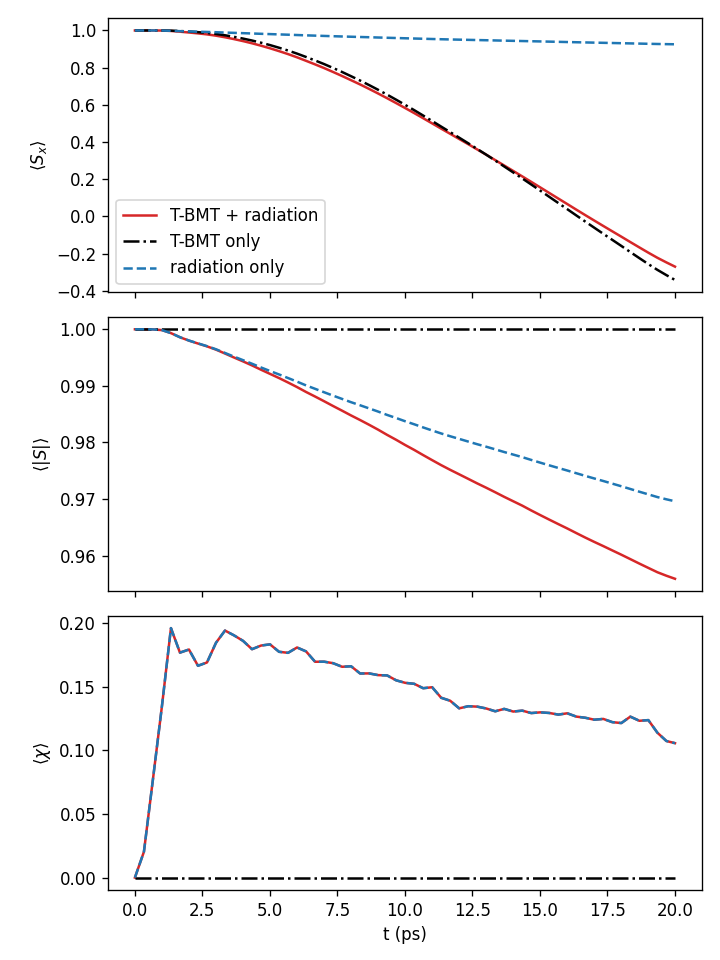

# Radiative depolarization of a TeV witness in a PWFA blowout (demo of the spin-resolved QED, decision 93)

A reduced version of the setup of O. Mathiak, L. Reichwein, A. Pukhov et al., arXiv:2605.19814 (Fig. 2), where the old VLPL
had this physics: a 500 GeV, 2.25 nC electron driver (sigma_x = 5 um, sigma_r = 1 um) in a 2.2e18 cm^-3 plasma with a 400 um
linear up-ramp; a 1 TeV witness (sigma = 2.5 um, 1.3 nC, the charge of the paper's Sec. III B) 66 um behind the driver, offset
by 10 um in y, initially polarized along x (S = (1, 0, 0)). Three runs: T-BMT and radiation (Monte Carlo, mixed states),
T-BMT only (`qed.model=none`), radiation only (`qed.spin_precession=false`).

Reduced against the paper: dx = 0.25 um, dy = dz = 0.5 um (paper 0.125 / 0.25 um; the driver's sigma_r is only 2 cells),
a 100 x 64 x 64 um box (paper 125 x 75 um), 1 plasma particle per cell (paper 16), Cart3D (RZ cannot hold the offset witness:
its density_function is f(z, r)), 20 ps (paper 80 ps). The comparison with the paper's curves is qualitative.

```
VLPL=build/vlpl sbatch -p <partition> bench/qed_pwfa/run.sbatch   # 3 runs, one 24-core node each (~4 h)
python3 bench/qed_pwfa/plot.py <run dir>      # pwfa_spin.png: <S_x>, <|S|>, <chi> of the three runs; prints the end values
```

## Results

the CPU cluster, 2026-11-10, branch qed-spin: 23983 steps (20 ps), one 24-core node per run, 4.4 h each (QED operator 1 % of the time,
the push / move split 8 %). `pwfa_spin.png`:



| run                | <S_x> | <S_y>  | <S_z> | <\|S\|> | <chi> (end) | chi_max | E_rad / E_0 |
|--------------------|-------|--------|-------|---------|-------------|---------|-------------|
| T-BMT + radiation  | -0.270| -0.696 | 0.091 | 0.9559  | 0.106       | 0.418   | 0.500       |
| T-BMT only         | -0.341| -0.729 | 0     | 1.0000  | 0           | 0       | 0           |
| radiation only     | 0.926 | 0.0001 | 0.091 | 0.9696  | 0.106       | 0.418   | 0.500       |

- <chi> rises to 0.19 when the witness enters the blowout (1.3 ps) and falls to 0.11 as it radiates: the witness radiates half
  of its initial energy in 20 ps. The radiated energy closes the balance: W_total(T-BMT + radiation) + E_rad equals
  W_total(T-BMT only) to 1.1e-5 (6.4977e9 vs 6.4976e9 m c^2; the two runs differ in their wakes).
- T-BMT turns the longitudinal spin by 115 degrees into -y (the offset plane) at |S| = 1 (no depolarization without emission).
  Radiation alone depolarizes slowly (|S| 0.970) and builds up S_z = 0.09 (radiative polarization along e2 = v x F, here
  normal to the offset plane). Together the depolarization is larger (|S| 0.956): precession turns the spin out of the
  direction that the radiative terms leave unchanged. Emission lowers gamma and so the precession angle a gamma theta: the
  T-BMT + radiation curve lags behind T-BMT only.
- Compared with arXiv:2605.19814 Fig. 2 (old VLPL, full size, 80 ps) the trends are the same (precession dominates <S_x>,
  radiation adds a slow monotonic depolarization); the reduced run is qualitative only (coarser grid, 1 particle per cell,
  smaller box, 20 ps).
- Gauss law. The runs above (before decision 91) had max|dGauss| 2.0e-3 at step 2000, growing with the up-ramp: the
  electron-only plasma column entering the window carried charge without a field. Since decision 91 that charge is folded
  into the initial residual, and the entry is exact: a rerun to 2.5 ps (qed.model = none, 2998 steps) gives 5.1e-13 at
  step 2000 and <= 1.2e-12 throughout, and without the beams <= 4e-19. What remained was 1.2e-4 at step 200 (7.2e-5 with
  dy = dz = 2 um) from the driver and witness self-fields: the zigzag field tail of the boosted Poisson operator ahead of the
  beams, cut at the right edge by the first window shift. With decision 95 (boost factor clamped per mode) it is gone:
  dy = dz = 2 um, 480 steps, <= 3.5e-14; initial W_field -0.09 %, at step 400 W_field 7e-5 and W_kin 8e-9 relative to
  the old run. The physics results above are not affected.
