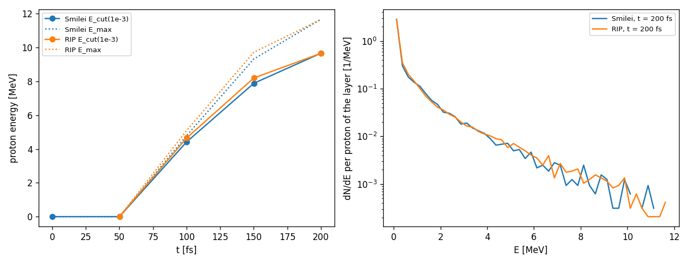
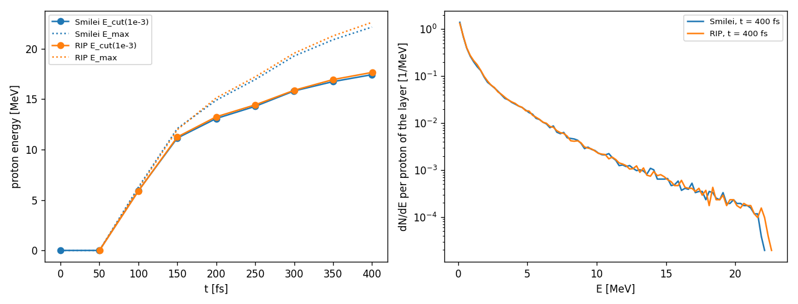

# TNSA: proton cutoff energy, VLPL against Smilei

Track O benchmark (docs/ROADMAP.md, Gate O: "TNSA: proton cutoff energy vs Smilei/EPOCH within 10 %"). Target normal
sheath acceleration of a hydrogen contaminant layer on the rear of a laser-irradiated foil, the same setup in both codes,
the same proton diagnostic and the same cutoff definition. Set up 2026-11-02: the **code check** (lambda0/32) and the
**benchmark run** (lambda0/64 x lambda0/32, 4 x 4 per cell, 400 fs, run on Alexander's go-ahead 2026-11-02): **E_cut(1e-3)
at 400 fs 17.65 MeV (VLPL-RIP 2D) against 17.43 MeV (Smilei), +1.3 %: Gate O passed** (section "Benchmark" below).

| | |
|---|---|
| geometry | 2D (x, y). Smilei: 2Dcartesian. VLPL: `grid.geometry = cartesian2d` (docs/specs/cart2d.md, since 2026-11-02; totals per slab dz = 0.4 um). The first code check ran VLPL as a Cart3D slab of 3 periodic z cells (dz = 0.4 um, identical particle copies in every z cell, the laser uniform in z) |
| laser | lambda0 = 0.8 um, a0 = 10 at the focus, 30 fs FWHM of the intensity, waist 3 um, E_y (in the plane), normal incidence, focus on the front surface of the plateau; the peak reaches it at 76.68 fs. VLPL: TFSF plane at x = 2.5 um with exact plane waves (`laser.tfsf_incident = modes`, decision 65); Smilei: LaserGaussian2D at xmin |
| target | C6+ foil, n_e = 40 n_c (n_C = n_e / 6, m_C = 12 x 1836), 1 um plateau, exponential pre-plasma L = 0.08 um cut at 5 L; hydrogen contaminant 0.1 um on the rear, protons + electrons at 10 n_c; all cold, neutral at t = 0, the foil fills all y; shape / interpolation order 2 (decision 64: >= 2 with a resolved ramp under p polarisation), Higuera-Cary in both |
| box | y 40 um periodic (fields and particles); x: VLPL 30 um with absorbing layers of 2 um at both ends (particles leave through x), Smilei 26 um = the RIP box between its layers (x' = x - 2 um), Silver-Mueller, particles removed at x. Front surface at x = 7.5 um (Smilei 5.5 um), 19.4 um of free space behind the foil |
| code check | dx = lambda0/32, dy = lambda0/16 (Smilei dt = 0.95 Courant, RIP-CC c dt = dx), 2 x 2 particles per cell and species, 200 fs. omega_p dt = 1.24 (40 n_c) in RIP-CC (it prints 1.39: the sum over the species' peak densities), c / omega_p = 0.8 dx |

## Cutoff definition (spectrum.py, the same for both codes)

Every proton is written every 50 fs (VLPL: `diagnostic protons { particles = true }`, raw float64 per rank; Smilei:
DiagTrackParticles of "proton", whose momenta are in m_e c and are divided by 1836). Kinetic energy (gamma - 1) m_p c^2
with m_p = 1836 m_e. Weights are normalised by their sum in the first dump (before the pulse reaches the foil), so
every number is per proton of the layer and the two codes' weight units drop out.
- **E_cut(f)**: the energy above which the protons carry the fraction f of the layer (cumulative weight from the top,
  interpolated between macro-particles). **E_cut(1e-3) is the cutoff of the criterion**; E_cut(1e-2), E_cut(1e-4)
  and the most energetic macro-particle E_max are reported.
- Also: N(> 1 MeV), the mean proton energy E_p per proton of the layer, the fraction that left the box, and dN/dE
  (bins of 0.25 MeV) in `<out>.spec`.
- `compare.py` interpolates the runs to common times and tests |E_cut(1e-3) / reference - 1| <= 10 % at the last time
  (exit status 1 otherwise).

Files: `rip.deck`, `run_rip.sbatch` (the CPU cluster), `smilei/tnsa.py` (Smilei 5.1; `TNSA_RES = code | bench | fine`, `TNSA_T`,
`TNSA_VACUUM`), `smilei/run_smilei.sbatch`, `spectrum.py`, `compare.py`. Runs in $WORK/tnsa on the CPU cluster.

    sbatch --export=ALL,RUN=rip_code,ARGS= bench/tnsa/run_rip.sbatch
    sbatch --export=ALL,TNSA_RES=code,TNSA_T=200,RUN=sm_code bench/tnsa/smilei/run_smilei.sbatch
    python bench/tnsa/compare.py Smilei=sm_code/tnsa_smilei.txt RIP=rip_code/tnsa_rip.txt --png code_check.png

The benchmark run (2 nodes for VLPL, 8 ranks along y; 1 node for Smilei):

    sbatch --export=ALL,RUN=rip2d_bench,ARGS="grid.nx=2400 grid.dx=0.0125um grid.ny=1600 grid.dy=0.025um grid.t_end=400.4fs \
      diagnostic\ protons.every=1200 output.every=1200 \"species electrons.ppc_x=4\" \"species electrons.ppc_y=4\" \
      \"species carbon.ppc_x=4\" \"species carbon.ppc_y=4\" \"species h_electrons.ppc_x=4\" \"species h_electrons.ppc_y=4\" \
      \"species protons.ppc_x=4\" \"species protons.ppc_y=4\"" bench/tnsa/run_rip.sbatch
    sbatch --export=ALL,TNSA_RES=bench,TNSA_T=400,RUN=sm_bench bench/tnsa/smilei/run_smilei.sbatch
    python bench/tnsa/compare.py Smilei=sm_bench/tnsa_smilei.txt RIP=rip2d_bench/tnsa_rip.txt --png bench.png

## Code check (2026-11-02, the CPU cluster)

Proton energies in MeV (Smilei the reference of the ratio):

| t [fs] | E_cut(1e-3) Smilei | VLPL | ratio | E_cut(1e-2) ratio | E_cut(1e-4) ratio | E_max Smilei / VLPL | N(>1 MeV) Smilei / VLPL |
|---|---|---|---|---|---|---|---|
| 100 | 4.42 | 4.65 | 1.051 | 1.079 | 1.039 | 4.79 / 5.09 | 0.071 / 0.074 |
| 150 | 7.89 | 8.20 | 1.040 | 1.057 | 1.033 | 9.32 / 9.72 | 0.118 / 0.115 |
| 200 | 9.67 | 9.66 | 0.999 | 1.059 | 1.000 | 11.67 / 11.66 | 0.134 / 0.130 |

- **E_cut(1e-3) at 200 fs: 9.666 MeV (Smilei) and 9.661 MeV (VLPL), -0.1 %**; E_cut(1e-4) and E_max agree to
  0.1 %. During the acceleration (100-150 fs) VLPL is 3-8 % ahead in all the cutoffs. The spectra dN/dE agree within
  the sampling noise down to 1e-3 per MeV (12 800 macro-protons in Smilei, 38 400 in VLPL: 3 z cells).
- Mean proton energy at 200 fs 0.437 (Smilei) and 0.457 MeV (VLPL) per proton of the layer (+4.5 %). No proton left
  the box.
- Kinetic energy of all particles over the analytic pulse energy (1.046e6 in VLPL units, 1.110e5 per unit z in Smilei
  units): 100 fs 0.190 (VLPL) / 0.175 (Smilei), 150 fs 0.159 / 0.121, 200 fs 0.146 / 0.105 (+ 0.002 carried out
  through x in Smilei). Before the pulse reaches the foil (50 fs) 0.0054 / 0.0042: heating of the cold dense foil at
  this resolution (omega_p dt = 1.24, c / omega_p = 0.8 dx). The absorption at the peak differs by 9 %, the energy kept
  by the particles afterwards by up to 40 %: to be checked at the benchmark resolution, where the plasma is resolved
  (VLPL writes no per-species energies yet; Smilei's split at 200 fs: foil electrons 0.049, C 0.033, protons 0.019,
  contaminant electrons 0.0035).
- VLPL: Gauss law max|dGauss| 9.1e-11 at max|rho| ~ 25-30 (3e-12 relative), max|div B| 8e-14; 1386 of 537 600 foil
  electrons and 59 of 38 400 contaminant electrons left through x.
- Smilei's incident pulse at the focus (vacuum run `TNSA_VACUUM=1`): max|E_y| 9.98, intensity FWHM 30.06 fs, peak at
  77.1 fs from a Gaussian fit of the envelope (VLPL: 76.68 fs). No amplitude correction is needed at normal
  incidence (the 45 deg injection of bench/hhg_oblique gave 0.82).
- Cost: **VLPL 7.2 core-hours** (536 s on 2 nodes x 24 cores, 2401 steps), **Smilei 0.27 core-hours** (41 s on 24
  cores). VLPL's time does not depend on the particles or the laser (96 steps on 24 cores: 38.8 s with
  the foil, 38.7 s in vacuum without laser; push_deposit 33 %, rip_cc 66 %): it is the per-cell work on the stored grid,
  whose z extent is several times the 3 physical cells because of the guard layers (at least 3 per side).
  A 2D-like run of VLPL therefore paid the 3D cost of a slab of 9 or more cells: hence the 2D geometry (below).

## Code check in 2D (2026-11-02, the CPU cluster, `grid.geometry = cartesian2d`)

The same deck in 2D (`rip.deck` now; the Cart3D slab above with `grid.geometry=cartesian grid.nz=3`). Gauss law max|dGauss|
1.1e-10 at max|rho| ~ 27 (as the Cart3D slab), div B 7e-17.

| run | cores | wall | core-hours | push_deposit / rip_cc |
|---|---|---|---|---|
| VLPL-RIP Cart3D slab, nz = 3 (above) | 2 x 24 | 532 s | 7.2 | 183 / 342 s |
| **VLPL-RIP 2D** | 2 x 24 (8 ranks x 6 threads) | **39.5 s** | **0.53** | 12.4 / 24.7 s |
| **VLPL-RIP 2D** | 24 (4 ranks x 6 threads) | **61.9 s** | **0.41** | 22.1 / 35.4 s |
| Smilei 2D | 24 (4 ranks x 6 threads) | 41 s | 0.27 | |

The 2D geometry makes the code check 13.5 times cheaper on the same 2 nodes (7.2 -> 0.53 core-hours); on one node it costs
1.5 times Smilei's core-hours (RIP-CC's field step, 57 %, is the larger part; c dt = dx with dx = lambda0/32).

Protons at 200 fs (MeV; per proton of the layer), and the dependence on the particles per cell (both codes run once more
with 2 x 6 per cell, the macro-particles per x-y cell of the Cart3D slab):

| run | E_cut(1e-3) | E_cut(1e-2) | E_cut(1e-4) | E_max | N(>1 MeV) | E_p |
|---|---|---|---|---|---|---|
| Smilei 2D, 2 x 2 | 9.67 | 5.25 | 11.51 | 11.67 | 0.134 | 0.437 |
| VLPL-RIP 2D, 2 x 2 (2 nodes / 1 node) | 10.09 / 10.30 | 5.73 / 5.74 | 12.15 / 11.84 | 12.29 / 11.84 | 0.155 / 0.156 | 0.518 / 0.513 |
| VLPL-RIP Cart3D slab, nz = 3 | 9.66 | 5.56 | 11.51 | 11.66 | 0.130 | 0.457 |
| Smilei 2D, 2 x 6 | 11.68 | 7.16 | 13.29 | 13.72 | 0.202 | 0.727 |
| VLPL-RIP 2D, 2 x 6 | 12.15 | 7.67 | 14.31 | 14.61 | 0.215 | 0.787 |

- VLPL-RIP 2D is 4 % above Smilei in E_cut(1e-3) at both particle numbers (1.043, 1.040), as the Cart3D slab was during
  the acceleration (3-8 % at 100-150 fs). The two VLPL-RIP 2D runs (8 and 4 ranks) differ by 2 % in E_cut(1e-3): round-off
  grows chaotically in the laser-plasma interaction, so this is the run-to-run spread of the code check.
- The code check is not converged in the particles per cell: both codes gain 20 % in E_cut(1e-3) and 50-65 % in E_p from
  2 x 2 to 2 x 6 (the cold 40 n_c foil with c / omega_p = 0.8 dx; the field energy at 200 fs halves, 38 -> 20 x 10^3 in
  VLPL units: much of it is particle noise). The benchmark resolution with 4 x 4 per cell (proposal below) addresses it.
- The Cart3D slab equals the 2D run only while it stays z-uniform: round-off between its z planes grows ~1e4 per 10 fs in
  the interaction (tests/test_cart2d.cpp), so after ~40 fs it is a 3D run of 3 periodic z cells with z dynamics and 3
  times the macro-particles. Its agreement with Smilei 2D at 200 fs (-0.1 %) was partly that.

## Benchmark (2026-11-02, the CPU cluster, 2D in both codes)

lambda0/64 x lambda0/32, 4 x 4 particles per cell and species (204 800 macro-protons in each code), 400 fs; omega_p dt =
0.69 in RIP-CC (Smilei dt = 0.95 Courant), c / omega_p = 1.44 dx. Everything else as in the code check. Proton energies in
MeV (Smilei the reference of the ratio):

| t [fs] | E_cut(1e-3) Smilei | VLPL | ratio | E_cut(1e-2) ratio | E_cut(1e-4) ratio | E_max Smilei / VLPL | N(>1 MeV) Smilei / VLPL | E_p ratio |
|---|---|---|---|---|---|---|---|---|
| 100 | 5.92 | 5.88 | 0.994 | 0.999 | 0.986 | 6.26 / 6.15 | 0.109 / 0.112 | 1.017 |
| 200 | 13.08 | 13.25 | 1.013 | 0.996 | 1.017 | 14.89 / 15.13 | 0.257 / 0.260 | 1.010 |
| 300 | 15.81 | 15.88 | 1.004 | 1.001 | 1.017 | 19.27 / 19.57 | 0.293 / 0.302 | 1.018 |
| 400 | 17.43 | 17.65 | **1.013** | 1.002 | 1.021 | 22.15 / 22.63 | 0.309 / 0.320 | 1.022 |

- **Gate O: E_cut(1e-3) at 400 fs 17.43 MeV (Smilei) and 17.65 MeV (VLPL), +1.3 % (tolerance 10 %).** At every dump
  from 100 to 400 fs all cutoffs agree within 2.1 %, the mean proton energy E_p within 2.2 %, N(> 1 MeV) within 3.6 %; the
  spectra dN/dE agree down to 1e-4 per MeV. No proton left the box.
- Against the code check (lambda0/32, 2 x 2 per cell, 4 % apart): resolving the plasma and 4 x as many particles brought the
  codes together; both cutoffs at 200 fs rose from ~10 to ~13 MeV (the code check was not converged, see above).
- VLPL: Gauss law max|dGauss| 5.6e-10 at max|rho| ~ 21 (3e-11 relative), div B 2e-17; 6549 foil electrons and 176
  contaminant electrons left through x.
- Cost: **VLPL 12.7 core-hours** (945 s on 2 nodes x 24 cores, 9603 steps; push_deposit 52 %, rip_cc 32 %, tile_sort
  14 %), **Smilei 8.0 core-hours** (1207 s on 24 cores). The tile sort (once per step on the CPU) is the visible overhead.
- Not run: Smilei at lambda0/128 (convergence of /64, ~80 core-hours): the two codes agree at /64 to 1-2 %, well inside
  the gate; worth it only if the absolute cutoff matters (Alexander's rule: convergence on small, fast cases).

## Proposal for the benchmark runs (Alexander's decision; the "bench" row was run, above)

Physics: the code-check target and laser (40 n_c C6+ foil 1 um, pre-plasma L = 0.08 um, H layer 0.1 um at 10 n_c,
a0 = 10, 30 fs, w0 = 3 um, normal incidence) at a resolution where the plasma is resolved, to 400 fs (the cutoff still
rises by 23 % from 150 to 200 fs in the code check; 20 MeV protons travel 18 um in 300 fs: the box keeps them).

| run | grid | ppc | omega_p dt | c/omega_p | VLPL | Smilei |
|---|---|---|---|---|---|---|
| bench | lambda0/64 x lambda0/32 | 4 x 4 | 0.62 | 1.6 dx | ~120 core-h (Cart3D slab), ~8 core-h (2D) | ~10 core-h |
| convergence | lambda0/128 x lambda0/64 | 4 x 4 | 0.31 | 3.2 dx | (~1000 core-h: not proposed) | ~80 core-h |

Estimates: the code check scaled with cells x steps (VLPL: the grid work dominates; Smilei: half its time in the
particles, x 4 for the particles per cell). Criterion: E_cut(1e-3) of VLPL /64 within 10 % of Smilei /64, Smilei /128
showing how far /64 is converged; VLPL's own convergence from the /32 code check to /64. Alternatives: a smaller box
(y 24 um, 15 um behind the foil, ~0.5 of the cost; the periodic y images of the hot electrons come closer), 100 n_c
(lambda0/100 for omega_p dt = 0.63, ~4 times the cost), oblique incidence (45 deg through the TFSF plane, Smilei's
injection amplitude corrected as in bench/hhg_oblique). The 2D mode exists now (estimate: the 2D code check x 8 for cells and
steps, its particle part x 4 for the particles per cell).
